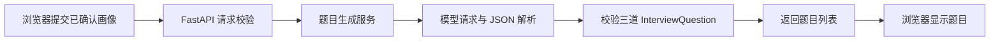

# Day 14 · 根据确认画像生成面试题

2026-11-15 开始。起点是 Day 13 提交 `a37729c`，全套离线测试为 `44 passed, 1 warning`。浏览器现在能让用户检查技能与项目、选择要保留的内容。今天新增一个后端接口，根据这份已确认画像生成面试题。

## 今天要完成的功能

浏览器把已确认的画像发送给 `POST /questions/generate`。FastAPI 校验请求，生成服务调用模型并检查回答，接口返回三个符合既有题目字段规则的问题。

请求只包含已确认的画像，例如用户选中了 FastAPI、pytest 两项技能和简历预览工具项目：

```json
{
  "profile": {
    "skills": [
      {
        "name": "FastAPI",
        "evidence": "我用 FastAPI 实现了文件上传"
      },
      {
        "name": "pytest",
        "evidence": "用 pytest 验证了空文件的处理"
      }
    ],
    "projects": [
      {
        "name": "简历预览工具",
        "evidence": "项目：简历预览工具。"
      }
    ]
  }
}
```

成功响应是一个 JSON 对象，包含三个题目。每题沿用 `InterviewQuestion` 的 `question`、`difficulty`、`knowledge_points` 字段，不提供答案。

```json
{
  "questions": [
    {
      "question": "在这个项目中，你怎样用 FastAPI 接收上传的文件？",
      "difficulty": "easy",
      "knowledge_points": ["FastAPI", "文件上传"]
    },
    {
      "question": "你如何验证简历预览工具处理空文件的行为？",
      "difficulty": "easy",
      "knowledge_points": ["pytest", "边界测试"]
    },
    {
      "question": "简历预览工具如何区分文件解码错误和空白内容？",
      "difficulty": "medium",
      "knowledge_points": ["文本解码", "输入校验"]
    }
  ]
}
```

模型返回的 JSON 顶层包含 `questions`。每题都要经过已有的 `InterviewQuestion` 规则校验。画像为空、字段缺失或格式不正确时，请求在模型调用前被拒绝，返回 422。模型配置、网络或输出处理失败时，由接口转换为简洁的 503 提示。

## 数据怎样流动



浏览器只发送用户勾选的画像。路由处理 HTTP 请求和状态码。生成服务处理提示词、模型请求、响应解析和数据规则。已有的 `InterviewQuestion` 描述单道题目的字段。

## 第一关 · 先写清请求和响应

暂时不改代码。用自己的话回答下面三个问题，再参考请求和响应样例检查理解。

1. 浏览器发给新接口的内容是什么？
2. 一道题有哪些字段？今天计划生成几道？
3. 用户没有勾选任何画像时，应该在发送模型请求前拒绝，还是先调用模型？

接口草案是 `POST /questions/generate`。请求体用 `profile` 包住已确认的技能和项目。成功响应是含 `questions` 列表的对象。学习者先读懂这个输入输出约定，再动手实现。

## 第二关 · 定义生成结果并做本地校验

新增 `GeneratedQuestionSet` 数据模型，包含 `questions: list[InterviewQuestion]`，将数量限制为刚好三道题。模型响应的每个元素使用已有的 `InterviewQuestion` 验证。

先用手写 JSON 调用 Pydantic 验证，不访问网络。练习正确的三题、两题、四题和一题字段缺失。逐一观察题目数量与字段校验分别发现什么问题。

## 第三关 · 定义请求模型和空画像规则

请求模型包含一个 `ResumeProfile` 字段。技能和项目沿用已经定义好的名称、引文结构。

两组列表可以合法地都为空，这是画像提取允许的结果。但生成面试题需要至少一个用户选中的条目。为生成接口单独定义这个业务校验，返回 422，并在测试里确认提取模型的函数没有被调用。

## 第四关 · 把模型调用放进生成服务

新增 `app/question_generation.py`。服务接收经过校验的 `ResumeProfile`，把条目名称与原文引文交给模型，要求根据这些已确认材料生成三道题，不包含答案，只返回规定字段的 JSON。模型输出经 JSON 解码后，通过 `GeneratedQuestionSet` 校验。

定义 `QuestionGenerationError` 报告可预期的配置、网络、上游 HTTP、响应结构、JSON 和字段错误。服务不打印内容，也不自行退出。沿用 Day 11 的分工，由调用者决定怎样展示结果。

## 第五关 · 增加 HTTP 路由

在 `app/main.py` 添加 `POST /questions/generate`。路由把请求中的画像交给服务，成功返回 `questions`。请求模型拒绝空画像时 FastAPI 返回 422，生成服务异常由路由转换成 HTTP 503 和统一提示。

## 第六关 · 验收接口

在 `tests/test_question_generation.py` 用 monkeypatch 替换路由实际调用的生成函数，覆盖成功、空画像和生成失败。

- 成功返回三道题，三个字段符合现有题目模型。
- 用户只选中的画像传给生成函数。
- 空画像返回 422，生成函数没有被调用。
- 生成失败返回 503 和统一提示。

生成服务本身使用模拟 HTTP 响应检查模型请求内容、合法三题和错误输出，不发送真实请求。页面调用新接口会在后续任务中进行。

运行单个新测试和全套测试，记录实际用例数量。再从 `/docs` 对虚构画像做一次真实模型请求，检查题目是否能对应到用户确认的技能、项目和引文。模型校验通过不代表问题一定合适，内容仍由人检查。
